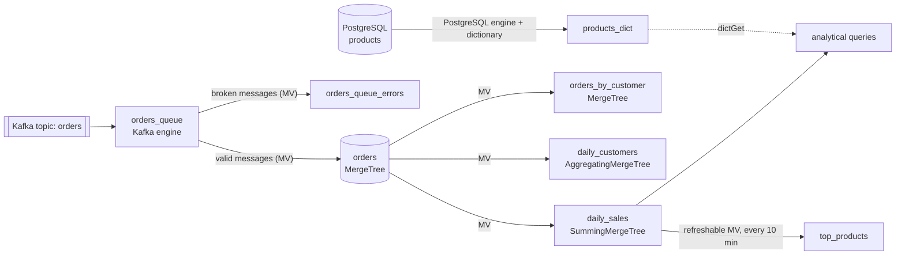

# Shopland: ClickHouse Analytical Data Warehouse

[](https://github.com/arman-h-alavi/shopland-clickhouse/actions/workflows/ci.yml)

An analytical warehouse for an online store's orders, built with **ClickHouse 26.8**, using **PostgreSQL 17** as the product catalog and **Kafka 4.0** as the live order stream. It is the final project of a ClickHouse course: 10 million generated orders, sub-second reports, and a full reproducible pipeline from `docker compose up`.

The full write-up (queries, real outputs and explanations for every question) is in Persian: [REPORT.md](REPORT.md).

## Architecture



## Repository layout

```text
.
├── docker-compose.yml          ClickHouse, PostgreSQL, Kafka
├── postgres/seed.sql           product catalog (5,000 products)
├── sql/
│   ├── 01_schema.sql           orders + naive comparison table
│   ├── 02_load.sql             10M generated orders, Parquet/CSV export, small-insert demo table
│   ├── 03_changes.sql         ReplacingMergeTree, mutations, lightweight delete, TTL
│   ├── 04_views_and_dictionary.sql   materialized views, PostgreSQL engine, dictionary
│   ├── 05_queries.sql          seven analytical queries
│   ├── 06_performance.sql      slow-query analysis and optimization
│   └── 07_kafka.sql            Kafka ingestion with error stream
└── .github/workflows/ci.yml    builds everything from scratch on every push
```

## Quick start

Requirements: Docker with Compose v2 and a few GB of free RAM (the heaviest single query in my runs peaked at about 0.9 GB).

```bash
docker compose up -d

# create the Kafka topic (the broker needs a few seconds to start)
until docker compose exec -T kafka /opt/kafka/bin/kafka-topics.sh --bootstrap-server kafka:9092 --list >/dev/null 2>&1; do sleep 2; done
docker compose exec -T kafka /opt/kafka/bin/kafka-topics.sh --bootstrap-server kafka:9092 --create --topic orders --partitions 3

# build the whole warehouse (takes a few minutes)
for f in sql/0*.sql; do
  docker compose exec -T clickhouse clickhouse-client \
    --user student --password student --database shop \
    --multiquery --format PrettyCompact < "$f"
done
```

Open an interactive client with
`docker compose exec clickhouse clickhouse-client --user student --password student --database shop`.

### Streaming new orders through Kafka

```bash
docker compose exec -T clickhouse clickhouse-client -u student --password student -q "
SELECT 20000000 + number AS order_id, rand(1) % 200000 + 1 AS customer_id, rand(2) % 5000 + 1 AS product_id,
       'Tehran' AS city, 'delivered' AS status, rand(5) % 5 + 1 AS quantity,
       (rand(6) % 2000 + 10) * 1000 AS unit_price, now() AS created_at
FROM numbers(1000) FORMAT JSONEachRow" \
| docker compose exec -T kafka /opt/kafka/bin/kafka-console-producer.sh --bootstrap-server kafka:9092 --topic orders
```

Rows arrive in `orders` and flow on into every materialized view. Malformed messages land in `orders_queue_errors`.

Verify it (new rows, the error stream and consumer lag):

```bash
docker compose exec -T clickhouse clickhouse-client --user student --password student --database shop --multiquery -q "
SELECT count() AS new_orders FROM orders WHERE order_id >= 20000000;
SELECT * FROM orders_queue_errors FORMAT Vertical"
docker compose exec kafka /opt/kafka/bin/kafka-consumer-groups.sh --bootstrap-server kafka:9092 --describe --group clickhouse_orders
```

The demo orders use fixed ids (`20000000 + n`), so sending the same batch twice inserts duplicates: the Kafka engine delivers at least once and `orders` is a plain `MergeTree`.

## Data model

| Object | Engine | Purpose |
|---|---|---|
| `orders` | MergeTree, `ORDER BY (city, created_at)`, monthly partitions | 10M orders |
| `orders_naive` | MergeTree, all `String`, no codecs | storage baseline |
| `orders_by_customer` | MergeTree, `ORDER BY (customer_id, created_at)` | fast customer lookup |
| `order_status_events` | ReplacingMergeTree | latest status per order |
| `daily_sales` | SummingMergeTree | pre-aggregated delivered revenue |
| `daily_customers` | AggregatingMergeTree | unique customers per day (`uniqState`) |
| `top_products` | refreshable materialized view | top 10 products, refreshed every 10 minutes |
| `products_dict` | dictionary on PostgreSQL | in-memory product lookup via `dictGet` |
| `orders_queue` | Kafka | consumer for the `orders` topic |

## Highlights (measured on a laptop, see the report for details)

| Topic | Result |
|---|---|
| Storage | the typed `orders` table is 116.12 MiB vs 310.19 MiB for the all-`String` table (62.6% smaller) |
| Customer lookup | 40.56 MiB read and 1228/1228 granules before; 79.75 KiB and 1/1221 granules after adding `orders_by_customer` |
| Small inserts | 500 single-row inserts create 500 parts; with async inserts (no waiting) only 20 |
| `FINAL` vs `argMax` | 17 ms vs 31 ms on 500k keys, with about 6x less memory for `FINAL` |
| Dictionary vs JOIN | `dictGet` 68 ms vs PostgreSQL JOIN 100 ms, and half the memory |
| Kafka | 1,000 streamed orders reached `orders` and `daily_sales` with consumer lag 0; one malformed message was kept in `orders_queue_errors` |

## Notes

- The order data is random and a fresh load gives different numbers; every number in the report comes from one load.
- The `student`/`student` credentials are for this local, throwaway setup only.
- CI starts all three services, runs every SQL file in order, and smoke-checks the results, including a Kafka round trip.
